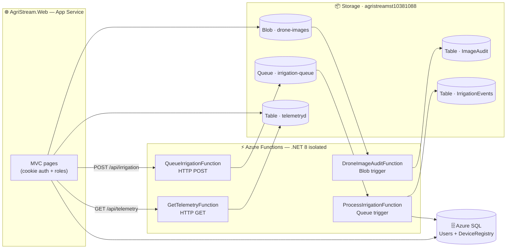

<div align="center">

# 🌾 AgriStream IoT

### Real-time smart-farm monitoring on Microsoft Azure

Soil telemetry · Drone imagery · Automated irrigation — built for the APDS7311 practicum

[](https://st10381088agri-f8c0d2cxc4c2aagq.southafricanorth-01.azurewebsites.net)
[](https://func-agristream-10381088-dbdfcebxdgcafsfa.southafricanorth-01.azurewebsites.net)


</div>

---

## 🔗 Where to find everything

| Resource | Type | Name | How to open it |
|---|---|---|---|
| 🌐 **Web app** | App Service | `st10381088agri` | ▶ **[Live site](https://st10381088agri-f8c0d2cxc4c2aagq.southafricanorth-01.azurewebsites.net)** · [Portal blade](https://portal.azure.com/#resource/subscriptions/e81cac15-7128-4116-a416-bc57e51fdbb8/resourceGroups/RSG-RCGPBR-ST10381088-SANORTH/providers/Microsoft.Web/sites/st10381088agri) |
| ⚡ **Function App** | Functions (.NET 8 isolated) | `func-agristream-10381088` | [Host page](https://func-agristream-10381088-dbdfcebxdgcafsfa.southafricanorth-01.azurewebsites.net) · [Portal blade](https://portal.azure.com/#resource/subscriptions/e81cac15-7128-4116-a416-bc57e51fdbb8/resourceGroups/RSG-RCGPBR-ST10381088-SANORTH/providers/Microsoft.Web/sites/func-agristream-10381088) → **Functions** lists all 4 |
| 🗄️ **SQL Database** | Azure SQL | `agristream` @ `agristream111` | [Portal blade](https://portal.azure.com/#resource/subscriptions/e81cac15-7128-4116-a416-bc57e51fdbb8/resourceGroups/RSG-RCGPBR-ST10381088-SANORTH/providers/Microsoft.Sql/servers/agristream111) → **Query editor** |
| 📦 **Storage account** | Blob · Table · Queue (LRS) | `agristreamst10381088` | [Portal blade](https://portal.azure.com/#resource/subscriptions/e81cac15-7128-4116-a416-bc57e51fdbb8/resourceGroups/RSG-RCGPBR-ST10381088-SANORTH/providers/Microsoft.Storage/storageAccounts/agristreamst10381088) → **Storage browser** |
| 🗂️ **Resource group** | — | `RSG-RCGPBR-ST10381088-SANORTH` | [Portal blade](https://portal.azure.com/#resource/subscriptions/e81cac15-7128-4116-a416-bc57e51fdbb8/resourceGroups/RSG-RCGPBR-ST10381088-SANORTH/overview) · Region: **South Africa North** |

**Function endpoints** (function key required — get the full URL via *Function → Get function URL*):

```
GET  https://func-agristream-10381088-….azurewebsites.net/api/telemetry?code=…&count=25
POST https://func-agristream-10381088-….azurewebsites.net/api/irrigation?code=…
```

---

## 🏗️ Architecture



<details>
<summary><b>📡 Data flow at a glance</b></summary>

| Flow | Path |
|---|---|
| 🌱 Telemetry ingest | `POST /api/telemetry` (sensors) or web form → table `telemetryd` |
| 📊 Dashboard read | MVC → **HTTP GET function** → `telemetryd` → JSON |
| 💧 Irrigation | MVC → **HTTP POST function** → `irrigation-queue` → **queue trigger** → SQL `DeviceRegistry` + `IrrigationEvents` |
| 🚁 Drone imagery | MVC upload → blob `drone-images` → **blob trigger** → `ImageAudit` row |
| 🛟 Graceful fallback | Function URL unset? Web app reads the table / enqueues directly — nothing breaks |

</details>

---

## ✨ Features (mapped to the practicum tasks)

| | Feature | Implementation |
|---|---|---|
| 🌐 | **Web hosting** (a) | ASP.NET Core 8 MVC on Azure App Service — sidebar app-shell UI, cookie auth |
| 👥 | **User & role management** (b) | Azure SQL `Users` table — salted SHA-256 hashes, roles `Farmer`/`Agronomist`/`Admin` |
| 📦 | **Blob + Table storage** (c) | `drone-images` container; `telemetryd`, `ImageAudit`, `IrrigationEvents` tables |
| ⚡ | **4-function pipeline** (d) | Blob · HTTP GET · HTTP POST · Queue triggers — see architecture above |
| 🔥 | **Load testing** (e) | `scripts/LoadTest.ps1` — concurrent workers, latency + failure stats |
| 📈 | **Monitoring** (f) | Application Insights on web + function app; Live Metrics during load |
| 📏 | **Auto-scaling** (g) | CPU-based rules on the App Service plan (scale-out >70 %, scale-in <30 %) |

---

## 📁 Repository layout

```
AgriStream.sln
├── 🌐 AgriStream.Web/           # MVC application → App Service
│   ├── Controllers/             # Account · Dashboard · Telemetry · Media · Irrigation · Admin
│   ├── Services/                # SqlService · StorageService · FunctionsClient · PasswordHasher
│   ├── Models/ · Views/ · Options/
│   ├── wwwroot/css/site.css     # theme: sidebar shell, parchment/navy/amber
│   └── Program.cs               # cookie auth · DI · App Insights · SQL auto-init
├── ⚡ AgriStream.Functions/      # .NET 8 isolated functions
│   ├── Functions/               # DroneImageAudit · GetTelemetry · QueueIrrigation · ProcessIrrigation
│   └── Support/Env.cs           # shared SDK client factory (Table / Queue / SQL)
├── 🗄️ sql/schema.sql            # Users + DeviceRegistry schema & seed
├── 🧪 scripts/
│   ├── LoadTest.ps1             # concurrent load generator (task e)
│   └── Send-Telemetry.ps1       # simulated sensor fleet → POST /api/telemetry
└── 📚 docs/
    ├── DEPLOYMENT.md            # full Azure provisioning & publish guide
    └── REPORT.md                # submission report + Section B theory
```

---

## 📦 Packages

<details>
<summary><b>🌐 AgriStream.Web</b></summary>

| Package | Version | Purpose |
|---|---|---|
| `Microsoft.Data.SqlClient` | 5.2.2 | Azure SQL access (users, device registry) |
| `Azure.Data.Tables` | 12.9.0 | Telemetry + audit tables |
| `Azure.Storage.Blobs` | 12.21.2 | Drone image uploads |
| `Azure.Storage.Queues` | 12.19.1 | Irrigation command fallback enqueue |
| `Microsoft.ApplicationInsights.AspNetCore` | 2.22.0 | Monitoring (task f) |

</details>

<details>
<summary><b>⚡ AgriStream.Functions</b></summary>

| Package | Version | Purpose |
|---|---|---|
| `Microsoft.Azure.Functions.Worker` | 1.22.0 | Isolated worker runtime |
| `Microsoft.Azure.Functions.Worker.Sdk` | 1.17.4 | Build-time function metadata |
| `Microsoft.Azure.Functions.Worker.Extensions.Http` | 3.2.0 | HTTP triggers |
| `Microsoft.Azure.Functions.Worker.Extensions.Storage.Blobs` | 6.6.0 | Blob trigger |
| `Microsoft.Azure.Functions.Worker.Extensions.Storage.Queues` | 5.5.0 | Queue trigger |
| `Azure.Data.Tables` | 12.9.0 | Table reads/writes inside functions |
| `Azure.Storage.Queues` | 12.19.1 | Queue writes inside functions |
| `Microsoft.Data.SqlClient` | 5.2.2 | `DeviceRegistry` update inside the queue function |

</details>

---

## 🗄️ Data model

### Azure SQL — `agristream` @ `agristream111.database.windows.net`

| Table | Purpose |
|---|---|
| `Users(Id, Username, PasswordHash, Salt, Role)` | Login credentials + roles |
| `DeviceRegistry(DeviceId, Name, DeviceType, Location, Status, LastCommandAt, UpdatedAt)` | Master registry the queue trigger updates |

Created & seeded automatically at startup (`SqlService.EnsureSchemaAsync`) — or manually via [`sql/schema.sql`](sql/schema.sql).

### Azure Storage — `agristreamst10381088` (Standard, LRS)

| Resource | ✍️ Written by | 👀 Read by |
|---|---|---|
| Blob `drone-images` | MVC upload (GUID-prefixed + uploader metadata) | `DroneImageAuditFunction` |
| Table `telemetryd` | MVC form / `POST /api/telemetry` | `GetTelemetryFunction`, dashboard |
| Table `ImageAudit` | `DroneImageAuditFunction` | Drone Imagery page |
| Table `IrrigationEvents` | `ProcessIrrigationFunction` | Audit / reporting |
| Queue `irrigation-queue` | `QueueIrrigationFunction` (or MVC fallback) | `ProcessIrrigationFunction` |

> 💡 Telemetry rows use `PartitionKey` = device ID + inverted-tick `RowKey`, so the newest readings sort first with **no scan**. Queue messages are Base64-encoded; the trigger decodes both forms, is idempotent, and failed messages dead-letter to `irrigation-queue-poison` after 5 attempts.

---

## ⚙️ Configuration

<details>
<summary><b>Web app — <code>Azure:*</code> settings</b></summary>

| Key | Value |
|---|---|
| `Azure:SqlConnectionString` | Azure SQL connection string |
| `Azure:StorageConnectionString` | Storage account connection string |
| `Azure:BlobContainerName` | `drone-images` |
| `Azure:TelemetryTableName` | `telemetryd` |
| `Azure:AuditTableName` | `ImageAudit` |
| `Azure:EventsTableName` | `IrrigationEvents` |
| `Azure:QueueName` | `irrigation-queue` |
| `Azure:TelemetryFunctionUrl` | GET function URL incl. `?code=` *(optional — direct-read fallback)* |
| `Azure:IrrigationFunctionUrl` | POST function URL incl. `?code=` *(optional — direct-enqueue fallback)* |

On App Service, use the double-underscore form: `Azure__TelemetryFunctionUrl`, etc.

</details>

<details>
<summary><b>Function app — application settings</b></summary>

| Key | Value |
|---|---|
| `AzureWebJobsStorage` | Storage connection string — **must be `agristreamst10381088`** (triggers + data live there) |
| `SqlConnectionString` | Azure **SQL** connection string — not the storage string |
| `TelemetryTableName` · `AuditTableName` · `EventsTableName` · `QueueName` | Optional — defaults already match (`Support/Env.cs`) |

</details>

---

## 🚀 Run locally

```powershell
dotnet build AgriStream.sln
dotnet run --project AgriStream.Web          # → http://localhost:5025
```

<details>
<summary><b>🛟 Fully local mode (Azurite) & local functions</b></summary>

```powershell
# Point storage at the emulator instead of Azure
$env:Azure__StorageConnectionString = "UseDevelopmentStorage=true"
dotnet run --project AgriStream.Web

# Run the functions locally (fill real conn strings into
# AgriStream.Functions/local.settings.json first — it's never published)
cd AgriStream.Functions
func start
```

</details>

### 👥 Seeded accounts

| Username | Password | Role |
|---|---|---|
| `admin` | `Admin@123` | 🔴 Admin |
| `farmer` | `Farm@123` | 🌾 Farmer |
| `agronomist` | `Agro@123` | 🔬 Agronomist |

### 🌱 Simulate sensor traffic

```powershell
.\scripts\Send-Telemetry.ps1 -BaseUrl "http://localhost:5025"
```

---

## ☁️ Deploy to Azure

Full guide: **[`docs/DEPLOYMENT.md`](docs/DEPLOYMENT.md)** — condensed:

1. 🌐 Create the App Service → publish `AgriStream.Web`
2. 🗄️ Create Azure SQL `agristream` (schema auto-creates + seeds on first run)
3. 📦 One storage account for blob + tables + queue
4. ⚡ Create the Function App (.NET 8 isolated) → publish `AgriStream.Functions`
5. 🔑 Set `AzureWebJobsStorage` + `SqlConnectionString` on the Function App
6. 🔗 Paste the two function URLs (with `?code=`) into `Azure__TelemetryFunctionUrl` / `Azure__IrrigationFunctionUrl`

---

## 🧪 Load test & monitoring

```powershell
.\scripts\LoadTest.ps1 -BaseUrl "https://st10381088agri-….azurewebsites.net" -TotalRequests 2000 -Concurrency 40
```

- 📈 **App Service → Metrics** — CPU %, requests, response time
- ⚡ **App Insights → Live Metrics** — requests arriving in real time
- 📏 **Autoscale → Run history** — scale-out / scale-in events

📄 Full submission report with screenshots + theory answers: **[`docs/REPORT.md`](docs/REPORT.md)**
